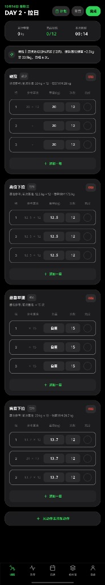
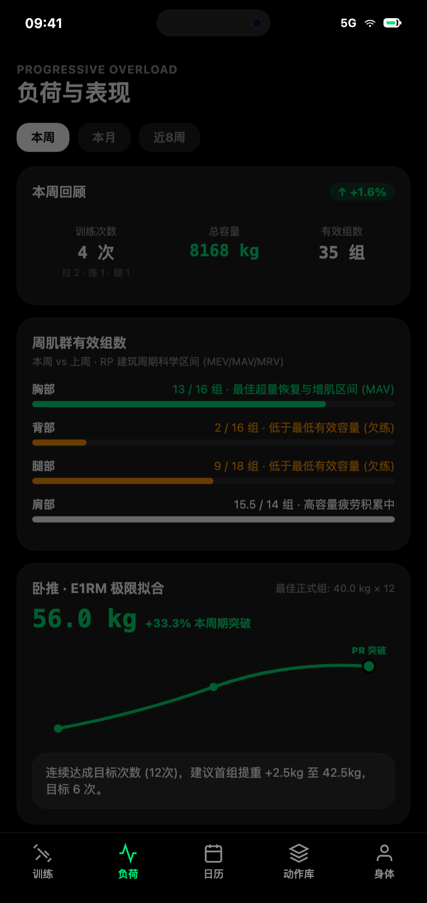
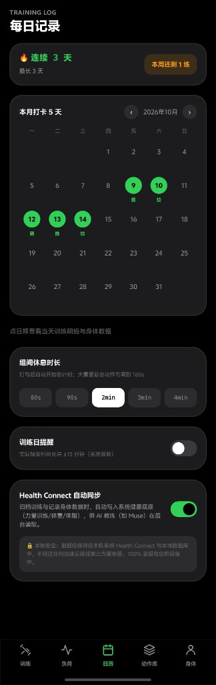
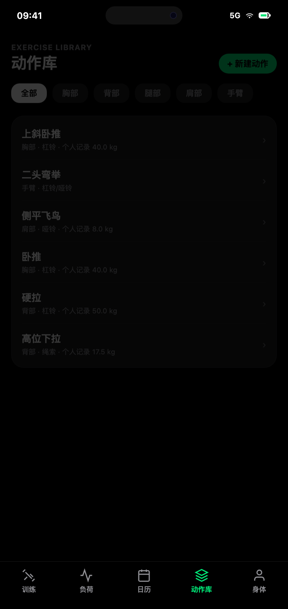
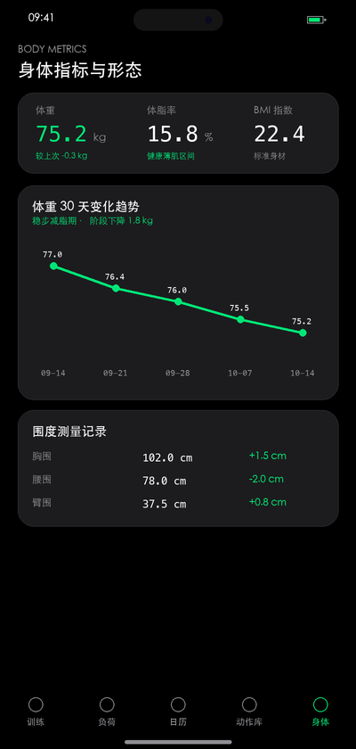

<div align="center">

# Rep

**Minimalist progressive overload workout tracker designed for hypertrophy training**

[English](README_EN.md) | [简体中文](README.md)

[](https://github.com/JY626/rep/releases/latest)
[](https://jy626.github.io/rep/)
[](https://kotlinlang.org/)
[](https://developer.android.com/jetpack/compose)
[-3DDC84?logo=android&logoColor=white)](https://developer.android.com/)
[](https://developer.android.com/health-and-fitness/guides/health-connect)
[](LICENSE)

<br/>

A modern, **100% offline-first** strength training logging app crafted with **Kotlin + Jetpack Compose (Material 3)**.<br/>
Engineered for **zero-friction logging, scientific progressive overload analytics, and body metric tracking**.<br/>
Follows **Apple Human Interface Guidelines (HIG)** obsidian dark mode aesthetic with crisp **Lucide vector icons**.

<br/>

### 📱 Preview (Screenshots)

> 💡 **Live Interactive Demo**: Try the full 1:1 pixel-perfect interactive web demo directly in your browser without installation! 👉 **[Click here to open Live Web Preview](https://jy626.github.io/rep/)** (Try checkmarking sets, volume calculation, rest timer countdown, and switching between all 5 tabs).

| Workout | Overload & Analytics | Calendar & Streak | Exercise Library | Body Metrics |
| :---: | :---: | :---: | :---: | :---: |
| <a href="https://jy626.github.io/rep/"></a> | <a href="https://jy626.github.io/rep/"></a> | <a href="https://jy626.github.io/rep/"></a> | <a href="https://jy626.github.io/rep/"></a> | <a href="https://jy626.github.io/rep/"></a> |

</div>

---

## ⚡️ Quick Start

### Option 1: Download Pre-built APK (Recommended)
Grab the signed, ready-to-install APK directly from GitHub Releases:
👉 **[Download Latest APK (v1.0.0)](https://github.com/JY626/rep/releases/latest)**

### Option 2: Build from Source
Zero external backend dependencies or API keys needed:
1. Clone repository:
   ```bash
   git clone https://github.com/JY626/rep.git
   cd rep
   ```
2. Open with Android Studio (Ladybug 2024.2+);
3. Build and install to your phone:
   ```bash
   ./gradlew assembleDebug
   adb install -r app/build/outputs/apk/debug/app-debug.apk
   ```

---

## 💎 Key Features

### 1. Zero-Friction Logging
- **Zero Keyboard Overhead**: Automatically backfills weights and reps from your previous session; checking off a set instantly inherits values into the next incomplete set.
- **48dp+ Large Hit Targets**: Tailored for shaky fingers post-exhaustion in gym environments.
- **Accurate Volume Calculation**: Automatically excludes warm-up sets (`WARMUP`) from total volume calculation, ensuring uncorrupted data.

### 2. Apple Watch-Style Floating Rest Timer Capsule
- Completing a set smoothly floats a translucent blurred pill timer at the bottom.
- Radial countdown ring with one-tap `+30s` extension and `Skip`, without blocking exercise library exploration.

### 3. Progressive Overload Analytics & Exercise PR Wall
- **E1RM Curve**: Calculates Estimated 1RM using the classic Epley formula: $1\text{RM} = \text{Weight} \times (1 + \text{Reps} / 30)$, dynamically graphing breakthrough curves and PR badges.
- **Exercise PR Wall**: Each exercise card highlights personal record badges. Tapping any movement reveals a dedicated PR Wall showcasing lifetime Estimated 1RM, max working weight, best volume set, and complete set timeline.
- **RP Volume Landmarks**: Tracks weekly effective sets across Chest, Back, Legs, Shoulders, Arms, and Core against MEV, MAV, and MRV thresholds.
- **Smart Double Progression**: Provides weight progression suggestions based on first-set targets (e.g., 60kg × 8 achieved → suggests 62.5kg × 6).

### 4. Calendar & Habit Tracking
- Color-coded monthly check-in grid (Push / Pull / Leg sessions).
- Tracks current streak and longest continuous training streak to reinforce gym habits.

### 5. Body Metric Quantization
- Records body weight, body fat %, chest, waist, and arm measurements.
- Computes BMI and delta trends compared to your previous weigh-in.

### 6. Health Connect Bidirectional Sync & AI Ecosystem (Muse)
- **Two-Way Health Connect Integration**: Automatically writes strength training sessions and weight/body fat into Android Health Connect; additionally supports **one-tap sync from Health Connect** to pull in smart scale and smartwatch weigh-ins seamlessly with deduplication.
- **AI Coach Ready**: AI coaches (like Muse) can query training progress via standard Health Connect APIs in the background; also supports one-tap structured Markdown cards via Android Sharesheet.

### 7. 100% Offline Data Backup & Restore
- **Instant JSON Export**: Package all workout sessions, sets, custom exercise catalog, and body metrics into a standard dated JSON file via system Sharesheet to cloud drives, file managers, or chat apps.
- **Lossless Restore**: Seamlessly recover your data when switching phones or reinstalling. Offers both smart "Merge Import" (recommended, deduplicating by timestamps) and "Overwrite Import".

---

## 📊 Feature Comparison

| Dimension | Paper & Pen | Bloated Commercial Apps | **Rep** |
| :--- | :---: | :---: | :---: |
| **Network** | 100% Offline | Requires internet, spins in gym basements | **100% Standalone Offline** |
| **Privacy** | Prone to loss | Uploads data to remote servers for monetization | **Zero servers, 100% on device** |
| **Data Backup** | Manual photos | Account-locked, hard to export | **One-tap JSON Export & Merge Restore** |
| **Friction** | Manual handwriting | Heavy UI, ads, and community distractions | **Auto-inheritance + 48dp+ blind taps** |
| **Scientific Overload** | None | Simple volume sum | **E1RM Curves + PR Wall + RP Thresholds** |
| **Ecosystem** | None | Walled garden | **Health Connect 2-Way + Markdown Export** |

---

## ❓ FAQ

<details>
<summary><b>Q1: Does Rep require an account or network connection?</b></summary>
<br/>
<b>No.</b> Rep is a pure offline utility without any login, account system, or remote servers. It functions flawlessly in basements or offline environments.
</details>

<details>
<summary><b>Q2: Where is my training data stored? How do I backup?</b></summary>
<br/>
All data is stored inside Android's app sandbox (SQLite via Room) and the system's Health Connect storage. Furthermore, Rep offers a robust <b>Data Backup & Restore</b> feature: export your full history to a standalone JSON file anytime in the Calendar tab, and restore it with one tap on a new device.
</details>

<details>
<summary><b>Q3: Do warm-up sets affect volume or 1RM?</b></summary>
<br/>
<b>No.</b> Warmup sets are excluded from total volume and RP muscle group thresholds to maintain scientific accuracy.
</details>

<details>
<summary><b>Q4: How does Health Connect synchronization work?</b></summary>
<br/>
Navigate to the Calendar tab and scroll to the Health Connect card. Tap "Grant Permission" to authorize exercise, weight, and body fat write permissions. If your device lacks Health Connect, Rep gracefully skips writing without interrupting local recording.
</details>

---

## 🛠 Architecture

<details>
<summary><b>Click to expand source directory layout</b></summary>

```
app/src/main/java/com/baoji/fitness/
├── core/
│   ├── theme/                 # Apple OLED dark theme, typography, tabular numbers
│   ├── designsystem/icons/    # Clean Lucide Compose vector icons
│   └── database/              # Room entities, DAOs, and preset seed data
├── domain/
│   ├── model/                 # Domain entities (WorkoutSession, WorkoutSet, WorkoutDayDetail)
│   └── algorithm/             # Overload, RP landmarks & Markdown formatter
├── data/
│   ├── repository/            # Repositories (WorkoutRepository, BodyMetricRepository)
│   ├── healthconnect/         # Health Connect writer (HealthConnectWriter)
│   ├── reminder/              # Periodic reminder work (WorkManager)
│   └── settings/              # Preferences & sync toggles
├── ui/
│   ├── workout/               # Main workout screen & rest capsule
│   ├── analytics/             # Overload dashboard & Canvas E1RM charts
│   ├── calendar/              # Calendar check-in, streak & Health Connect settings
│   ├── library/               # Exercise library & custom movements
│   ├── body/                  # Body metric logging and trends
│   ├── components/            # AI Share BottomSheet and reusable widgets
│   └── navigation/            # 5-Tab frosted bottom bar & scaffold host
├── BaojiApplication.kt        # App DI & Health Connect repository binding
└── MainActivity.kt            # Edge-to-edge entry activity & rationale routing
```

</details>

---

## 🤝 Contributing

Contributions are warmly welcomed! Please check our [Contributing Guide](CONTRIBUTING.md) for setup and guidelines.

---

## 📄 License

Rep is licensed under the [MIT License](LICENSE).
